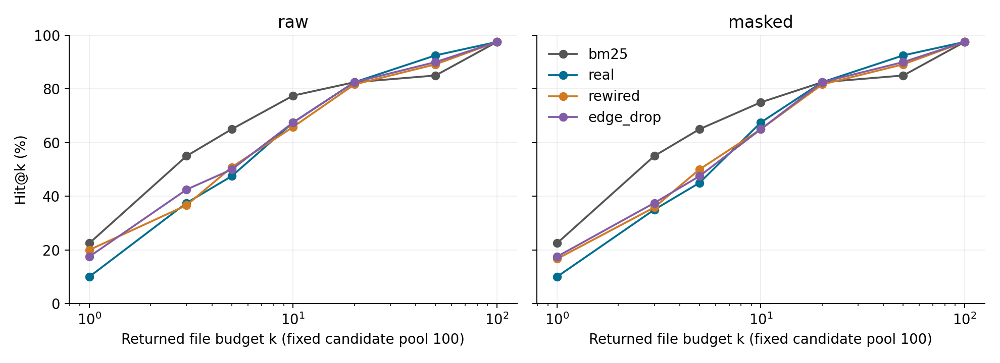

# PatchScope-CF: Do Code Graphs Really Help Locate Bugs?

**Subtitle:** A counterfactual, leakage-audited benchmark for repository-level issue localization.

## Abstract

Code graphs are often added to coding-agent retrieval, but their value can be confounded by lexical evidence, node popularity, and candidate exposure. PatchScope-CF is a CPU-only evaluation resource that compares a lexical baseline with an issue-conditioned import-graph reranker, directed-degree-preserving rewired graphs, and edge deletion inside identical candidate pools. We freeze forty SWE-bench Lite test issues across seven repositories before measuring performance and index each exact pre-fix commit. Three rewiring seeds and an explicitly label-informed target-name masking diagnostic separate topology changes from query information removal. On raw issues, BM25 achieves 65.0% Hit@5, the real graph 47.5%, and rewired controls 50.8%. The real-minus-BM25 difference is −17.5 percentage points, with a descriptive 95% paired-bootstrap interval of [−32.5, −2.5]; the real-minus-rewired interval includes zero. Masking changes twelve queries and provides no evidence of graph advantage. A separate twenty-three-issue dev evaluation also favors BM25 at Hit@5. The resource includes immutable manifests, source checksums, auditable controls, per-instance rankings, tests, and reporting commands. These pilot results caution against assuming that static import propagation improves localization; they do not establish conclusions about other graphs, language models, or downstream repair.

## 1. Motivation

Finding relevant files is an upstream bottleneck for coding agents. A graph may improve retrieval because its dependencies are useful, because popular nodes receive extra weight, or because an expanded pool exposes more relevant code. Comparing a graph method only with lexical retrieval cannot distinguish these explanations. We ask a narrower question: does the actual import topology improve fixed-pool ranking beyond lexical evidence and a graph with the same node degrees?

A negative result is useful when the intervention and failure cases are inspectable. Our goal is a lightweight resource for auditing graph additions, rather than another graph-localization or patch-generation system.

## 2. Contributions and resource

PatchScope-CF packages frozen-commit data acquisition, reproducible patch-to-file labels, a gold-blind AST index, lexical retrieval, graph perturbations, target-name auditing, paired evaluation, and a CLI. It preserves selection and exclusions, records successful swaps, and exports complete candidate rankings rather than only aggregate scores.

The contribution is the practical combination of a directed-degree-preserving topology intervention, identical lexical candidate pools, and an explicitly diagnostic query-masking condition. We claim neither the first graph localizer nor the first counterfactual, masking, or leakage-aware retrieval evaluation.

## 3. Data and protocol

We use SWE-bench Lite [1,6], Hugging Face revision `b0dde1093fe417d83b7184254edf8199c1f0dff5`. Before label extraction or test scoring, we sorted all 300 test IDs, shuffled with Python `random.Random(2026)`, and selected the first 40 without replacement. All 40 were eligible: Django 17, SymPy 6, Sphinx 6, scikit-learn 5, Matplotlib 3, Requests 2, Pylint 1. There were zero case exclusions. This is a deterministic pilot subset, not a representative estimate for all Lite.

Each issue has a distinct exact `base_commit`. Git blobs from that commit supply the index; no solution is applied, no upstream setup runs, and no fixed branch is checked out. Solution patches supply only evaluation labels through unified-diff destination paths. Test patches and hints never enter queries, indexing, seeds, or ranking. Selection manifests, tree/source checksums, and a regression test that changes future metadata audit this boundary.

Eligible labels and candidates are Python source files. Documented path/name rules exclude tests, docs, examples, generated/vendor directories and setup/config files. Symlinks and files over 250,000 bytes are excluded; snapshots are capped at 20,000 eligible files. Every filtered gold path must exist at base; otherwise the whole case is excluded without replacement. All selected cases have one gold file, so Recall@k equals Hit@k here; multi-file behavior is unit-tested but not empirically demonstrated in this cohort. Filename heuristics cannot identify every vendored/generated file.

The raw condition uses only `problem_statement`. The masked condition removes matched gold paths, canonical dotted module names, and guarded unique basenames/stems. Short/common ambiguous bare stems are retained. The matcher records original offsets/text and verifies removal of matched patterns. Twelve issues have 34 matched spans; this counts the configured matcher, not every possible semantic clue. This is a **label-informed information-removal stress-test**, not a deployment rule or a causal estimate by itself. Only query text changes.

The first five selected test cases were used as engineering smoke checks, so this is not a pristine untouched holdout. Bugs were repaired without tuning ranking parameters, and superseded outputs are retained. A separate full dev run contains 23 eligible issues, zero exclusions, and six different repositories. No hyperparameter search was conducted on either split; dev results are descriptive rather than a tuning claim.

## 4. Methods

**Shared representation.** Documents contain path/module tokens and AST function, class and method names, imports, and docstrings, capped at 24,000 characters. Tokenization splits camel/acronym/snake forms into lowercase ASCII letter/digit tokens; no stopwords are removed. Fifteen files in one historical Requests snapshot fail AST parsing and retain path/module text; the audit lists them. No source snippets, solution information, models, or embeddings are used.

**BM25.** Positive-IDF BM25 uses k1=1.5 and b=0.75; repeated query terms count once. Ties resolve by path. Every method receives the same lexical scores, top-20 seeds, and top-100 candidate pool (or all files when fewer exist). This controls pool composition as well as count, while preventing graph discovery outside that pool.

**Real graph.** Nodes are indexed files; directed edges go from importer to an exactly resolved internal module. Relative imports and root/src/lib layouts are supported; unresolved externals are omitted. This is an incomplete static import graph, not a call graph. Let l(v) be BM25 normalized by the maximum score. A candidate receives

`s(v) = l(v) + 0.5 × Σ[l(u) / outdegree(u)]`,

where u ranges over top-20 seed files with an edge to v. Degrees include successors outside the pool. This fixed one-hop residual rule is deliberately simple and unoptimized.

**Rewired control.** Directed double-edge swaps preserve every node's exact in/out degree and the node/edge counts, rejecting duplicates and self-loops. Seeds are 2026/2027/2028. We request five successful swaps per edge, bounding attempts at twenty times that target. Every requested swap completed across all 120 test control graphs; median retained-edge fraction is 0.170. Bounded swaps are not proved to sample a uniform null or to mix fully. Their scores average within each issue before inference.

**Edge deletion.** A seeded control retains floor(E/2) edges and every node. It is an ablation, not a degree-matched null: deleting edges also changes propagation denominators.

**Metrics and uncertainty.** Hit@1/5/10 measures any gold hit; MRR@10 is reciprocal first-hit rank, zero beyond ten; Recall@k is the fraction of gold files returned. The primary table includes all four families and both conditions on the same cases. Paired issue bootstrap uses 2,000 replicates and seed 2026. Intervals describe this sample, assume exchangeable issues, ignore repository clustering, and are not multiplicity-adjusted confirmatory tests.

## 5. Results

All entries below use n=40 issues. Rewired values average three seeds per issue. Query timings are milliseconds: median/P95 across issues after within-issue warm measurements.

| Condition | Method | n | Hit@1 | Hit@5 | Hit@10 | MRR@10 | Recall@5 | Median / P95 ms |
|---|---|---:|---:|---:|---:|---:|---:|---:|
| masked | bm25 | 40 | 22.5% | 65.0% | 75.0% | 0.399 | 65.0% | 1.25 / 2.32 |
| masked | real | 40 | 10.0% | 45.0% | 67.5% | 0.277 | 45.0% | 1.29 / 2.37 |
| masked | rewired | 40 | 16.7% | 50.0% | 65.0% | 0.308 | 50.0% | 1.30 / 2.38 |
| masked | edge_drop | 40 | 17.5% | 47.5% | 65.0% | 0.313 | 47.5% | 1.29 / 2.36 |
| raw | bm25 | 40 | 22.5% | 65.0% | 77.5% | 0.403 | 65.0% | 1.33 / 2.67 |
| raw | real | 40 | 10.0% | 47.5% | 67.5% | 0.282 | 47.5% | 1.39 / 2.71 |
| raw | rewired | 40 | 20.0% | 50.8% | 65.8% | 0.327 | 50.8% | 1.38 / 2.73 |
| raw | edge_drop | 40 | 17.5% | 50.0% | 67.5% | 0.327 | 50.0% | 1.37 / 2.70 |

Raw real-minus-BM25 Hit@5 is **−17.5 percentage points**, 95% paired interval **[−32.5, −2.5]**. Against the rewired mean it is **−3.3 points [−12.5, +5.0]**: inconclusive, with no demonstrated topology advantage. Under masking these differences are **−20.0 [−35.0, −5.0]** and **−5.0 [−13.3, +3.3]**, respectively. Masking does not reveal a hidden advantage; raw/masked are paired diagnostics, not independent replications.



The budget curves show BM25 ahead at small k, while larger outputs can favor the real graph. All methods converge at the full common pool by construction. This makes output budget part of the empirical question; these runs do not show universal graph harm.

In the separate dev run, raw Hit@5 is BM25 65.2%, real 60.9%, rewired 55.1%, edge deletion 60.9% (n=23). These are not pooled with test results. Test repository slices vary: scikit-learn drops from 4/5 BM25 hits to 1/5 real hits, while Requests stays 2/2; these small subgroups are descriptive.

Warm raw query medians range from 1.33 to 1.39 ms. Separately, median AST construction is 816.22 ms, BM25 construction 29.17 ms, and combined graph-control preparation 124.73 ms. Median cached snapshot loading is 23.84 ms; this is **not cold network acquisition time**. Timings are hardware-specific measurements under concurrent work, not speedup claims.

## 6. Failure analysis and limitations

A positive raw case is `django__django-10924`: gold `django/db/models/fields/__init__.py` moves from BM25 rank 7 to real-graph rank 2. Real top two are `django/conf/__init__.py` and the gold file. A negative case is `django__django-12453`: gold `django/db/backends/base/creation.py` falls from rank 5 to 8; `django/core/exceptions.py` and `django/conf/__init__.py` become the real top two. Complete top tens, commits and all rank changes are exported. Common dependencies receiving transferred score are a plausible explanation, not a separately proven causal mechanism. Across raw cases, first-gold rank improves in 10, worsens in 24, and is unchanged in 6.

The null intervention changes topology while preserving node popularity as measured by degree; it does not hold every graph statistic fixed. Import edges miss dynamic behavior and calls. Index representation and an unoptimized outgoing propagation rule constrain the conclusion. Gold patches identify one accepted modification, not every useful context file; all observed gold nodes have nonzero graph degree, so there is no isolated-gold subgroup comparison. Masking can remove useful ordinary text and retain indirect clues. Repository imbalance, historical vendoring, one-file labels, limited null seeds, and issue-correlated bootstrap uncertainty restrict generalization. No downstream repair, LLM, or Gemma experiment was run.

## 7. Related work

SWE-bench [1] supplies real issue/patch pairs and pre-fix states. LocAgent [2] already establishes graph-guided localization and graph ablations. Agent Retrieval Bench [3] evaluates frozen-commit workflow-context retrieval with leakage checks and wrong-repository controls. Bellam [4] studies structural tools with random-entity placebos, matched output formats/budgets, and gold-definition masking. Caumartin et al. [5] examine retrieval-oriented representations and reranking. These precedents rule out broad priority claims. PatchScope-CF instead offers a small model-free implementation of a same-degree import-topology intervention inside identical lexical pools, alongside a distinct target-name **query** stress-test. We do not directly compare scores across these different tasks and protocols.

## 8. Reproducibility

Measured on Apple M2, 8 logical CPUs, 8 GiB memory, macOS arm64, Python 3.12.4, CPU only, on November 12, 2026. Direct dependencies and transitive lockfile are supplied. From the resource root:

```sh
uv sync --locked --extra test
uv run --locked pytest -q
uv run --locked python examples/demo.py
uv run --locked patchscope evaluate --sample 40 --seed 2026 \
  --manifest data/selection_manifest.json --output results/reproduction
uv run --locked patchscope report --results results/reproduction
```

Use a fresh output directory when one already exists; runs are protected against overwrite. Results include 480 test rows, configuration/source hashes, snapshot provenance, exact rankings, masking spans, exclusions, and descriptive slices. Original code is MIT licensed; upstream dataset/repository terms remain separate. Cached source, full issues and patches are not release assets. Public project/notebook link: **TO BE UPLOADED**. Replace this only with an actual accessible upload; the local artifact is not yet public.

AI assistance was used for implementation, tests, analysis and drafting. The entrant must review the evidence and accept responsibility for the final submission; no human review is implied by this draft.

## 9. Conclusion

For this fixed-pool pilot and ranking rule, real import propagation reduces small-budget accuracy relative to BM25 and offers no demonstrated Hit@5 advantage over degree-preserving rewiring. The reusable contribution is an auditable protocol that makes such negative and inconclusive outcomes reproducible. Different graph construction, learned weighting, candidate discovery or agents require new experiments.

## References

1. Carlos E. Jimenez et al. (2024). *SWE-bench: Can Language Models Resolve Real-World GitHub Issues?* [arXiv:2310.06770](https://arxiv.org/abs/2310.06770).
2. Zhaoling Chen et al. (2025). *LocAgent: Graph-Guided LLM Agents for Code Localization.* ACL, 8697–8727. [doi:10.18653/v1/2025.acl-long.426](https://aclanthology.org/2025.acl-long.426/).
3. Bowen Qin and Yi Xie (2026). *Agent Retrieval Bench: Evaluating Repository Context Retrieval for Coding Agents.* [arXiv:2607.24882](https://arxiv.org/abs/2607.24882).
4. Saurav Bellam (2026). *How Much Do Structural Tools Help Small Coding Agents? A Pre-Registered Scale Study of Code Localization.* Version 2. [arXiv:2610.33958](https://arxiv.org/abs/2610.33958).
5. Genevieve Caumartin, Tse-Hsun (Peter) Chen, and Diego Elias Costa (2026). *Retrieval-Oriented Code Representations in Agentic Bug Localization.* [arXiv:2607.11046](https://arxiv.org/abs/2607.11046).
6. SWE-bench. *SWE-bench Lite dataset*, pinned revision above. [Dataset card](https://huggingface.co/datasets/SWE-bench/SWE-bench_Lite).
