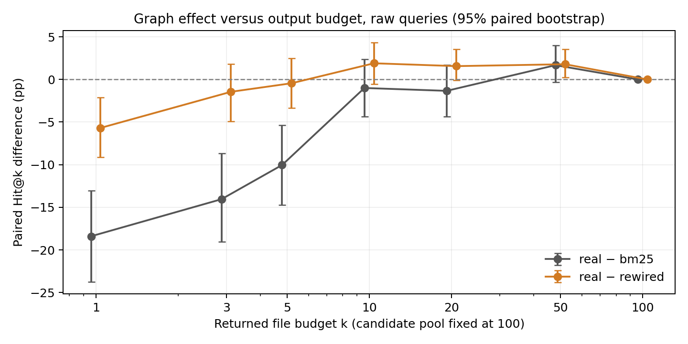
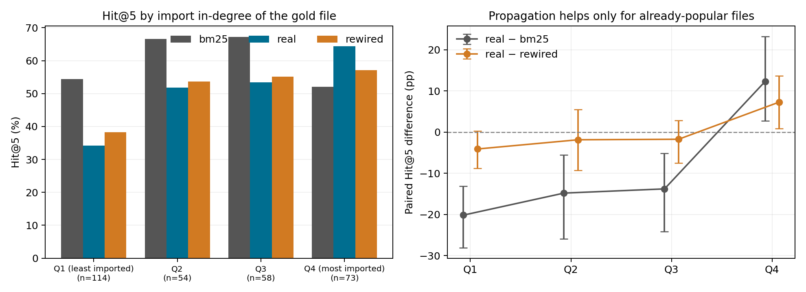

# PatchScope-CF: Do Code Graphs Really Help Locate Bugs?

**Subtitle:** A counterfactual, leakage-audited benchmark showing that one-hop import propagation is a popularity prior in disguise.

## Abstract

Code graphs are routinely added to coding-agent retrieval, and the usual evidence is that a graph-assisted retriever beats a lexical baseline. That comparison cannot separate dependency structure from node popularity. PatchScope-CF is a model-free, CPU-only evaluation resource that holds the candidate pool, index, lexical scores and output budget identical across arms and varies only topology: the real import graph, three **directed degree-preserving rewired** graphs, and a 50% edge-deleted graph. We evaluate the complete SWE-bench Lite test split — 299 of 300 issues, 12 repositories, each indexed at its exact pre-fix commit. One-hop import propagation *reduces* Hit@5 by 10.0 points against BM25 (95% paired bootstrap [−14.7, −5.4]) and MRR@10 by 14.5 [−17.9, −10.9]. Against the degree-preserving null it is indistinguishable at Hit@5 (−0.4 [−3.3, +2.5]) and **worse** at the top of the ranking (Hit@1 −5.7 [−9.1, −2.1]). Splitting issues by gold-file in-degree explains why: propagation gains +12.3 points when the target is among the most-imported quarter of files and loses 20.2 when it is among the least-imported, and a random graph with the same degrees reproduces much of that gain. Masking target names out of queries does not change the ordering, and no graph weight, seed budget or edge direction in a dev-split sweep rescues it.

## 1. Introduction and research questions

Before a coding agent can fix an issue it has to find the files to read. On a repository with thousands of modules that step bounds everything downstream, and adding a code graph is a common way to try to improve it. The usual evidence is that a graph-assisted retriever beats a lexical baseline — which cannot say *why*: a graph changes the candidate pool, re-weights heavily imported nodes, and encodes dependency structure all at once. If a graph helps only because it promotes widely imported files, a random graph with the same degree sequence should help just as much, and the dependency structure is doing no work.

PatchScope-CF separates those explanations. Its central control is a **directed degree-preserving rewiring**: every node keeps its exact in-degree and out-degree, the node and edge counts are unchanged, and only *which* files are connected changes. Any gap between the real and rewired arms is attributable to topology; anything they share is attributable to popularity.

- **RQ1.** Inside a fixed lexical candidate pool, does real import topology rank gold files higher than lexical evidence alone?
- **RQ2.** Does real topology beat a degree-preserving null — is there signal in the edges beyond node popularity?
- **RQ3.** If not, is that an artifact of the propagation weight, the seed budget, the edge direction, or the number of files returned?
- **RQ4.** Does removing the target file's own name from the issue text reveal a structural advantage otherwise hidden by surface lexical overlap?

The answers are negative, with one informative exception that identifies the mechanism. The contribution we claim is the resource and the protocol that make such answers checkable, not a new retriever.

## 2. Related work

SWE-bench [1] supplies the issue/patch pairs and pre-fix `base_commit` states that make frozen-commit evaluation possible; its own task is patch generation, of which localization is one upstream component. LocAgent [2] establishes graph-guided localization with LLM traversal over heterogeneous code graphs and ablates traversal, relation types and BM25 indexing — graph-based localization and graph ablations predate this work and we claim no priority for them. Agent Retrieval Bench [3] evaluates repository-context retrieval at frozen commits with leakage checks and a wrong-repository counterfactual, which swaps the corpus rather than perturbing topology at fixed degree. Bellam [4] runs a pre-registered scale study of structural tools for small agents, with a placebo replacing returned entities by random same-repository definitions and masking of gold definitions in tool output; placebo and masking methodology is therefore also established. Caumartin, Chen and Costa [5] compare retrieval-oriented code representations, supporting a fixed index representation across arms.

What PatchScope-CF packages, and we did not find combined elsewhere, is a *directed degree-preserving* perturbation of a code graph evaluated inside *identical candidate pools*, plus a query-side name-removal diagnostic and a provenance audit, in a laptop-CPU toolkit. We ran no systematic review, so this is bounded negative evidence about priority, not a claim of being first.

## 3. The PatchScope-CF framework

A small Python package and a two-command CLI (`evaluate`, `report`) implement a fixed pipeline. **Pinned acquisition:** metadata at a pinned revision, with the cohort frozen into an immutable manifest before any label extraction or scoring; a mismatched cohort aborts the run rather than silently changing the benchmark. **Read-only snapshots:** each issue's exact `base_commit` tree is read from a bare clone with `ls-tree` and `cat-file` — no checkout, no patch application, no upstream setup script ever executes — and tree and source hashes are re-verified on cache reuse. **Gold-blind indexing:** the index sees only base-commit source (path and module tokens, AST names, import targets, docstrings); patches, hints and future test files cannot reach it, enforced by module boundaries and by a regression test that mutates future metadata and asserts rankings do not move. **Labels:** destination paths of the solution diff, parsed with hunk-state tracking; if any filtered gold path is absent at base the whole case is excluded and logged, never silently shrunk.

Everything downstream of `per_instance.csv` is derived, so a reader can recompute every number here. `scripts/verify_results.py` does so independently — re-deriving metrics from saved rankings, re-checking candidate-pool equality and seed sets, and re-reading snapshots to confirm source hashes. `scripts/paper_numbers.py` reprints every figure quoted here; `scripts/check_paper.py` re-checks this paper's table against `summary.csv`.

## 4. Experimental methodology

**Cohort.** The **complete SWE-bench Lite test split, all 300 issues**, at revision `b0dde1093fe417d83b7184254edf8199c1f0dff5`; using the whole split leaves no sampling decision to bias the outcome. 299 were eligible across 12 repositories (Django 114, SymPy 77, scikit-learn 23, Matplotlib 22, pytest 17, Sphinx 16, Astropy 6, Requests 6, Pylint 6, xarray 5, seaborn 4, Flask 3), spanning 296 distinct base commits. The one exclusion, `matplotlib__matplotlib-24149`, is a protocol exclusion: its gold file exceeds our 250,000-byte indexing cap. Every eligible issue has exactly one gold file, so Recall@k equals Hit@k throughout. An earlier 40-issue pilot is retained unchanged in `results/`; it is the first 40 of the same deterministic shuffle and nests inside this cohort. Five of those were engineering smoke checks — 1.7% of issues here — and no ranking parameter was ever tuned on a test label.

**Queries.** The raw condition uses `problem_statement` verbatim. The masked condition removes matched gold paths, canonical dotted module names and guarded unique basenames and stems, retaining short or ambiguous bare stems. Only the query text changes. This is a **label-informed stress test**, not a deployment transform.

**Arms.** All arms share one BM25 model, one set of lexical scores, the same top-20 seeds and the same top-100 pool, returning the same 100 paths reordered. BM25 is positive-IDF, k1=1.5, b=0.75, over camel/acronym/snake-split lowercase tokens. The real graph has a directed edge from each importer to each exactly resolved internal module. With `l(v)` the BM25 score normalised by the maximum, a candidate scores `l(v) + 0.5 × Σ l(u)/outdeg(u)` over seeds `u` with an edge `u→v`. Rewired controls (seeds 2026/2027/2028) apply directed double-edge swaps preserving every node's exact in- and out-degree, five successful swaps per edge requested; all 897 control graphs completed every requested swap, median retained-edge fraction 0.162. Edge deletion retains ⌊E/2⌋ edges. All parameters were fixed before the run.

**Inference.** Rewiring seeds are averaged within an issue before aggregation so controls cannot pseudo-replicate. Uncertainty is a paired issue-level bootstrap, 2,000 replicates, seed 2026. Intervals are descriptive: they assume exchangeable issues, ignore repository clustering, and are not adjusted for the many metrics and slices reported.

## 5. Results and statistical analysis

| Condition | Method | n | Hit@1 | Hit@5 | Hit@10 | MRR@10 | Recall@5 | Median / P95 ms |
|---|---|---:|---:|---:|---:|---:|---:|---:|
| masked | bm25 | 299 | 25.4% | 53.8% | 61.5% | 0.371 | 53.8% | 1.26 / 2.49 |
| masked | real | 299 | 10.7% | 43.8% | 59.5% | 0.242 | 43.8% | 1.30 / 2.54 |
| masked | rewired | 299 | 13.8% | 45.5% | 57.6% | 0.267 | 45.5% | 1.31 / 2.54 |
| masked | edge_drop | 299 | 13.0% | 41.5% | 57.5% | 0.250 | 41.5% | 1.30 / 2.53 |
| raw | bm25 | 299 | 29.8% | 58.5% | 64.9% | 0.410 | 58.5% | 1.32 / 2.78 |
| raw | real | 299 | 11.4% | 48.5% | 63.9% | 0.265 | 48.5% | 1.37 / 2.83 |
| raw | rewired | 299 | 17.1% | 48.9% | 62.0% | 0.301 | 48.9% | 1.37 / 2.84 |
| raw | edge_drop | 299 | 14.4% | 45.8% | 63.5% | 0.276 | 45.8% | 1.36 / 2.82 |

**RQ1 — real topology versus lexical evidence.** Adding the real import graph *costs* accuracy. On raw queries Hit@5 falls 10.0 points [−14.7, −5.4], MRR@10 falls 14.5 points [−17.9, −10.9], and Hit@1 falls 18.4 points [−23.7, −13.0]. Across issues whose first-gold rank moved at all, 59 improved and 189 worsened.

**RQ2 — real topology versus a degree-preserving null.** The real graph is not distinguishable from randomly rewired edges with identical degrees: Hit@5 −0.4 points [−3.3, +2.5]. Where they do differ near the top of the ranking, the **real graph is worse**: Hit@1 −5.7 [−9.1, −2.1] and MRR@10 −3.6 [−6.0, −1.3]. Real topology beats the null only at a large output budget, k=50, by +1.8 points [+0.2, +3.6].

**Where the effect lives.** It is not one repository's quirk: real is below BM25 at Hit@5 in 6 of 12 repositories, level in 5, ahead in one (xarray, n=5). The loss is largest in matplotlib (50.0% → 27.3%), pytest (41.2% → 23.5%) and scikit-learn (69.6% → 47.8%).

**RQ3 — budget, weight, seeds, direction.** The sign of the effect depends on how many files are returned. Real minus BM25 is −18.4 at k=1, −10.0 at k=5, −1.0 [−4.3, +2.3] at k=10 and +1.7 [−0.3, +4.0] at k=50, converging to zero at the shared full pool. Propagation damages exactly the small budgets an agent uses. On the **dev split only** — six repositories disjoint from the test cohort — we swept α over {0, 0.1, 0.25, 0.5, 0.75, 1.0}, the seed budget over {5, 10, 20, 50}, and the propagation direction. No setting beat α = 0, pure lexical ranking; Hit@5 and MRR@10 decline roughly monotonically in α for the real graph *and* the control; reversing edge direction is worse still (52.2% vs 58.5% mean Hit@5 over the α > 0 grid); and the best cell of the 72 belongs to a **random control**, which is what selection noise looks like.

**Protocol stability.** Between the pilot and this run the only changed source file is `data.py`, and only in how it fetches and caches git objects: the recorded hashes of all nine ranking-relevant modules are byte-identical, and all 480 pilot rows reproduce inside this run with zero ranking disagreements.

## 6. Counterfactual findings

The degree-preserving control tells us the graph is acting like a popularity prior. The subgroup analysis shows it directly. Splitting the 299 issues by the import in-degree of their gold file:

| Gold file in-degree | n | BM25 | real | rewired | real − BM25 | real − rewired |
|---|---:|---:|---:|---:|---|---|
| Q1, 0–2 (least imported) | 114 | 54.4% | 34.2% | 38.3% | −20.2 [−28.1, −13.2] | −4.1 [−8.8, +0.3] |
| Q2, 3–4 | 54 | 66.7% | 51.9% | 53.7% | −14.8 [−25.9, −5.6] | −1.9 [−9.3, +5.6] |
| Q3, 5–8 | 58 | 67.2% | 53.4% | 55.2% | −13.8 [−24.1, −5.2] | −1.7 [−7.5, +2.9] |
| Q4, 9–155 (most imported) | 73 | 52.1% | 64.4% | 57.1% | **+12.3 [+2.7, +23.3]** | +7.3 [+0.9, +13.7] |

Propagation helps if and only if the target is already heavily imported, and hurts badly otherwise. A graph with the same degrees and randomly attached edges captures a large share of the Q4 gain (+5.0 of the +12.3 against BM25) — precisely the confound a lexical-only baseline cannot expose. Genuine topology signal does exist, real beating the null by +7.3 points in Q4, but only where popularity already points the right way. This split is exploratory and unadjusted; in-degree also correlates with file size and centrality, which we did not disentangle.

The promotion pattern matches. The files the real graph most often pushes into its top three are each repository's utility hubs: `django/core/exceptions.py` (45 issues), `sympy/core/compatibility.py` (32), `django/conf/__init__.py` (22), `django/utils/functional.py` (20), `sklearn/utils/validation.py` (17). When the gold file *is* such a hub the graph wins dramatically — `django__django-11564` moves from BM25 rank 66 to rank 1, `django__django-13220` from 29 to 1. Otherwise hub promotion evicts the right answer: in `matplotlib__matplotlib-25498` gold `colorbar.py` falls from 1 to 8 behind `__init__.py`, `cbook.py` and `colors.py`; in `pytest-dev__pytest-8365` gold `tmpdir.py` falls from 1 to 6 behind `compat.py` and `config/__init__.py`.

**RQ4 — masking.** The diagnostic changed 135 of 299 queries, matching 403 spans. It lowers every method, as expected, but leaves the ordering intact: real minus BM25 is again −10.0 [−14.7, −5.4], real minus rewired inconclusive at −1.7 [−4.5, +1.1]. Surface name overlap was not hiding a structural advantage.

**Edge deletion.** Halving the edges is slightly worse than keeping them (real minus edge-drop Hit@5 +2.7 [+0.0, +5.4]) while staying far below BM25 — consistent with the amount of diffusion mattering more than which edges carry it. It is an ablation, not a degree-matched null: deleting edges also changes propagation denominators.

**Cost.** The whole 299-issue evaluation takes 8 min 6 s on one CPU with warm snapshots; median per-query ranking is 1.32–1.37 ms and offline construction 827 ms (AST index), 30 ms (BM25) and 128 ms (all controls). Descriptive single-machine measurements, not speedup claims.

## 7. Limitations and threats to validity

**Construct.** Gold paths are the files one accepted patch touched, not exhaustive relevance; a promoted file may be genuinely useful and still score as a miss. File retrieval is an upstream proxy for issue resolution — we ran no agent, no language model and no repair evaluation, so nothing here measures fix rates, and nothing here used Gemma.

**Internal.** The import graph is static and incomplete: exact internal module imports only, missing dynamic imports, call edges and namespace packages. The propagation rule is one fixed, unlearned one-hop residual. Fixed pools isolate reranking but make graph-based *discovery* outside the lexical top-100 impossible by construction — arguably the main way graphs are expected to help, and the main reason this result is not "code graphs do not work". Degree preservation controls popularity but not clustering, reciprocity or path structure, and bounded swaps are not proved to sample a uniform null. Masking is label-informed and changes the task.

**External.** SWE-bench Lite is Python-only, every issue has a single-file gold patch, and two repositories supply 64% of the issues. Results are specific to this index, ranking rule and budget set. Issue-level bootstrap intervals assume exchangeable issues and ignore repository clustering, so they understate uncertainty; metrics and slices are unadjusted for multiplicity, and the in-degree split is post-hoc.

## 8. Conclusion

Across the complete SWE-bench Lite test split, adding real static import structure to a lexical retriever made issue-to-file localization *worse* at the budgets agents actually use, and what effect remained was not distinguishable from a graph with the same degree sequence and randomly attached edges — at the very top of the ranking it was measurably worse than that null. Changing the propagation weight, the seed budget or the edge direction does not rescue it, and removing target names from the queries does not reveal a hidden advantage. The subgroup analysis names the mechanism: one-hop import propagation behaves as a prior on heavily imported files, which is why it wins big on the quarter of issues whose target is a hub and loses badly on the rest.

We are not concluding that code graphs are useless. We are concluding something narrower and checkable: *this* kind of graph — static import edges, one-hop propagation, reranking inside a lexical pool — buys little that node popularity does not already buy, and a paper reporting a graph win against a lexical baseline alone has not ruled that explanation out. The cheapest fix is the degree-preserving control, which costs one function call and three random seeds.

The resource is the contribution. PatchScope-CF runs on a laptop CPU in minutes, exports every ranking it produced, re-verifies its own artifacts, and will say the same thing about any other graph, ranking rule or budget dropped into it. The experiments it most obviously enables next — call graphs, pool *expansion* rather than reranking, and a real agent consuming the ranked files — are exactly the ones this design cannot answer alone.

**Code, data manifests, full results and figures:** <https://github.com/sakshamg251206/patchscope-cf> (MIT or Apache-2.0). Reproduce with `sh scripts/reproduce_all.sh`. AI assistance was used for implementation, analysis and drafting; the entrant has reviewed the evidence and is responsible for the claims.

## References

1. Carlos E. Jimenez, John Yang, Alexander Wettig, Shunyu Yao, Kexin Pei, Ofir Press, and Karthik Narasimhan (2024). *SWE-bench: Can Language Models Resolve Real-World GitHub Issues?* [arXiv:2310.06770](https://arxiv.org/abs/2310.06770).
2. Zhaoling Chen et al. (2025). *LocAgent: Graph-Guided LLM Agents for Code Localization.* ACL 2025, 8697–8727. [doi:10.18653/v1/2025.acl-long.426](https://aclanthology.org/2025.acl-long.426/).
3. Bowen Qin and Yi Xie (2026). *Agent Retrieval Bench: Evaluating Repository Context Retrieval for Coding Agents.* [arXiv:2607.24882](https://arxiv.org/abs/2607.24882).
4. Saurav Bellam (2026). *How Much Do Structural Tools Help Small Coding Agents? A Pre-Registered Scale Study of Code Localization.* [arXiv:2610.33958](https://arxiv.org/abs/2610.33958).
5. Genevieve Caumartin, Tse-Hsun (Peter) Chen, and Diego Elias Costa (2026). *Retrieval-Oriented Code Representations in Agentic Bug Localization.* [arXiv:2607.11046](https://arxiv.org/abs/2607.11046).
6. SWE-bench. *SWE-bench Lite dataset*, revision `b0dde1093fe417d83b7184254edf8199c1f0dff5`. [Dataset card](https://huggingface.co/datasets/SWE-bench/SWE-bench_Lite).
